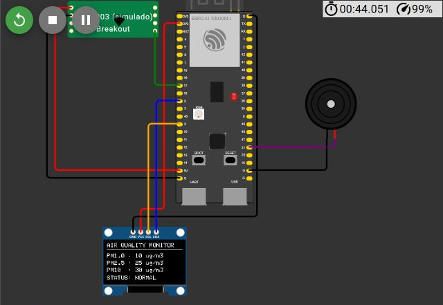
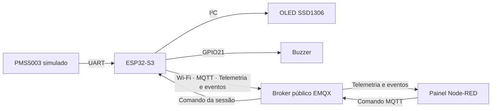

# Monitor de material particulado com ESP32-S3 e MQTT

Protótipo simulado que lê PM1.0, PM2.5 e PM10 de um PMS5003, exibe os valores em um OLED e aciona um buzzer quando PM2.5 ultrapassa 50 µg/m³. O ESP32-S3 também publica as leituras pela internet e recebe comandos de autoteste de um painel Node-RED. O limiar é experimental e as concentrações são simuladas.





## Arquivos do projeto

| Pasta | Conteúdo |
| --- | --- |
| [`firmware/demonstracao/`](firmware/demonstracao/) | Código e montagem para execução normal. |
| [`firmware/medicao/`](firmware/medicao/) | Variante com marcadores e analisador lógico para os ensaios de tempo. |
| [`firmware/teste-rede/`](firmware/teste-rede/) | Variante que simula perda e recuperação da conexão com o broker. |
| [`node-red/`](node-red/) | Fluxo importável, fontes do painel e configuração local. |
| [`dados/`](dados/) | Logs, capturas lógicas, resultados calculados e registros de falhas. |
| [`scripts/`](scripts/) | Cliente MQTT, decodificador VCD, análise e geração de resultados. |
| [`docs/`](docs/) | Protocolo, resultados, diagnóstico dos brokers e instruções de ensaio. |

## Montagem

A montagem principal usa o ESP32-S3-DevKitC-1 do Wokwi, o chip personalizado PMS5003, um OLED SSD1306 e um buzzer. O circuito foi avaliado em simulação, sem gabinete. O arquivo [`diagram.json`](firmware/demonstracao/diagram.json) contém as conexões exatas.

| Componente | Sinal | Pino do ESP32-S3 ou alimentação |
| --- | --- | --- |
| PMS5003 | TX do sensor | GPIO17, RX da UART1, 9600 bit/s, 8N1 |
| PMS5003 | VCC e GND | 5 V e GND |
| OLED SSD1306 | SDA e SCL | GPIO8 e GPIO9, I²C a 400 kHz, endereço `0x3C` |
| OLED SSD1306 | VCC e GND | 3,3 V e GND |
| Buzzer | Sinal e retorno | GPIO21 e GND, tom de 4 kHz |

O GPIO18 está reservado como TX da UART1. A montagem usa apenas o envio do sensor para o ESP32. O chip simulado gera um pacote a cada 1 s. O firmware valida o cabeçalho, o comprimento e o checksum antes de atualizar a amostra. O OLED e o buzzer continuam operando quando a tarefa de rede perde a conexão. Os controles e as regras do modelo estão em [Modelo PMS5003](docs/Modelo-PMS5003.md).

## Executar a demonstração

1. Abra um projeto ESP32-S3 no Wokwi. No editor do diagrama, adicione um **Custom Chip** em C com o nome `pms5003` para criar as abas do chip. Coloque nas abas os cinco arquivos da pasta [`firmware/demonstracao/`](firmware/demonstracao/) e inicie a simulação. O monitor serial registra `WIFI OK` e `MQTT CONNACK OK` quando as conexões são abertas. [Chips personalizados](https://docs.wokwi.com/chips-api/getting-started) · [Wi-Fi no Wokwi](https://docs.wokwi.com/guides/esp32-wifi)
2. Em uma instalação do Node-RED, instale o FlowFuse Dashboard (`@flowfuse/node-red-dashboard`). Use **Import** para carregar [`node-red/flows.json`](node-red/flows.json), clique em **Deploy** e abra [localhost:1880/painel/ar](http://localhost:1880/painel/ar) na porta padrão. [Instalação do FlowFuse Dashboard](https://dashboard.flowfuse.com/getting-started.html)
3. Aguarde o painel indicar **ESP32 · Online**. No controle do PMS5003, teste 25, 50 e 51 µg/m³ de PM2.5. O buzzer só entra em alerta automático acima de 50 µg/m³. Volte a 25 µg/m³ e clique em **Testar buzzer · 1 s**. Compare o ID de envio, início e conclusão no painel e na serial.
4. Para testar o sensor, use o controle **Falha**. O modo 1 corrompe o checksum, o modo 2 suspende os pacotes e o modo 0 restaura a transmissão. O painel diferencia uma amostra inválida com o ESP32 online da perda de conexão.

O Node-RED também pode ser iniciado com as versões fixadas no repositório. Execute na pasta raiz, com Node.js 24 e pnpm 11.25.0 instalados. O arquivo `pnpm-workspace.yaml` dispensa apenas o script de pós-instalação informativo do `core-js`; os pacotes continuam instalados conforme o lockfile.

```powershell
Set-Location node-red
pnpm install --frozen-lockfile
pnpm exec node-red --userDir . --settings settings.js
```

Essa configuração abre o editor em [127.0.0.1:1889](http://127.0.0.1:1889/) e o painel em [127.0.0.1:1889/painel/ar](http://127.0.0.1:1889/painel/ar). O fluxo grava os comandos em `comandos-buzzer.jsonl` na pasta de execução. As versões registradas no ensaio foram Arduino-ESP32 3.3.12, ESP-IDF 5.5.5, Node.js 24.22.1, Node-RED 4.1.6 e FlowFuse Dashboard 1.32.0. As versões de PubSubClient, Adafruit GFX e Adafruit SSD1306 estão em [`libraries.txt`](firmware/demonstracao/libraries.txt).

Se a porta 1889 já estiver em uso, acrescente `--port 1891` ao comando de execução e abra o painel em `http://127.0.0.1:1891/painel/ar`.

A [validação da integração](docs/Validacao-Integracao.md) registra a instalação, os casos conferidos e as evidências.

## Comunicação e falhas

O ESP32 acessa a internet pela rede simulada `Wokwi-GUEST` e usa MQTT 3.1.1 sobre TCP/IP com `broker.emqx.io:1883`. A configuração pública usa dados simulados e TCP sem criptografia. Execute uma instância por vez com o prefixo `obj-intelig-projeto/pm/47db91f2`. A sessão permite endereçar o comando ao ESP32 conectado. O broker público permite acesso de outros clientes às mensagens. [Configuração do EMQX público](https://www.emqx.com/en/mqtt/public-mqtt5-broker)

O ESP32 envia telemetria a cada 5 s, com QoS 0 e sem retenção. O painel usa a presença retida para obter o tópico da sessão. Com 15 s sem telemetria recente, desabilita o botão e deixa de exibir as últimas concentrações. O firmware expira a amostra após 5 s sem pacote válido. Durante o autoteste, o buzzer toca pela duração aceita e depois volta ao estado ditado pelo alerta local. Os tópicos, exemplos de mensagens e o procedimento da falha de rede estão em [`docs/Protocolo-MQTT.md`](docs/Protocolo-MQTT.md).

## Medições e resultados

Foram aceitas quatro medições da geração do pacote no sensor ao recebimento MQTT e quatro da publicação do comando ao primeiro pulso no GPIO21. As médias estimadas foram **970 ms** para o sensor, com intervalo de **510 a 1.440 ms**, e **490 ms** para o buzzer, com intervalo de **0 a 990 ms**. A [tabela e as figuras dos resultados](docs/Resultados.md) indicam os limites e as versões usadas.

Para reproduzir a análise dos registros já coletados, execute a partir da raiz com Python 3.13.

```powershell
python scripts/verificar_medicao.py dados/medicoes/01 --pm25 28 --id 4001
python scripts/verificar_medicao.py dados/medicoes/02 --pm25 33 --id 4101
python scripts/verificar_medicao.py dados/medicoes/03 --pm25 38 --id 4201
python scripts/verificar_medicao.py dados/medicoes/04 --pm25 45 --id 4301
python scripts/consolidar_medicoes.py
```

Para repetir o ensaio com o analisador lógico ou gerar as figuras novamente, veja [`docs/Reproduzir-medicoes.md`](docs/Reproduzir-medicoes.md). Os registros de origem estão em [`dados/medicoes/`](dados/medicoes/) e as ocorrências de rede em [`docs/Diagnostico-Brokers.md`](docs/Diagnostico-Brokers.md).

Os arquivos VCD preservam as capturas do analisador lógico byte por byte. Nos registros textuais dos ensaios, os rótulos de versão, tópicos e prefixos de cliente foram padronizados com os nomes usados nesta distribuição. Os valores, as marcas de tempo, os IDs numéricos dos comandos e a associação entre eventos foram preservados. As imagens de funcionamento são recortes das capturas dos ensaios. O manifesto `SHA256SUMS.txt` identifica os arquivos distribuídos.
