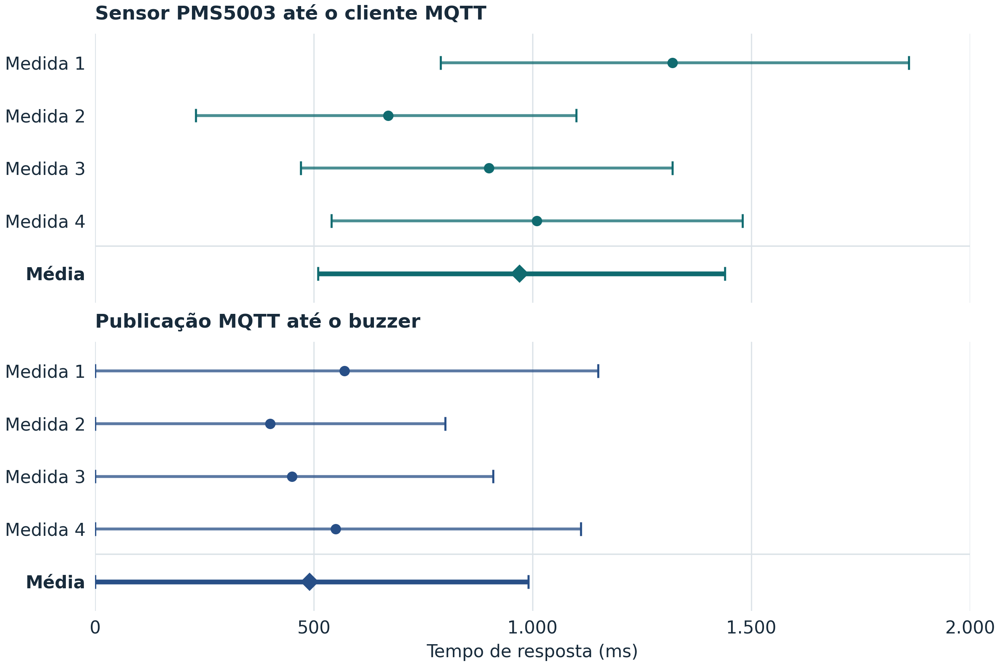
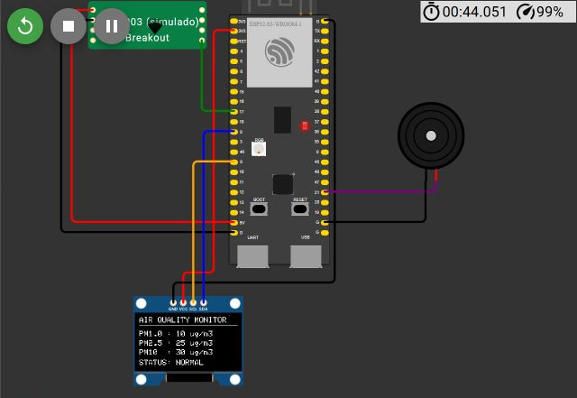
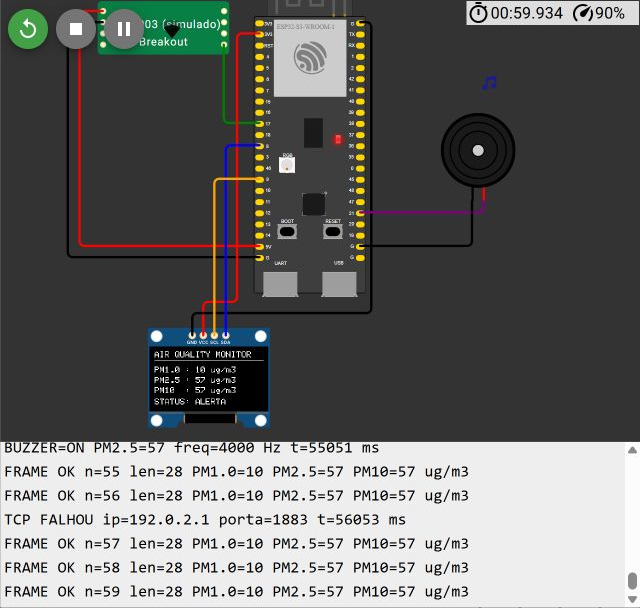
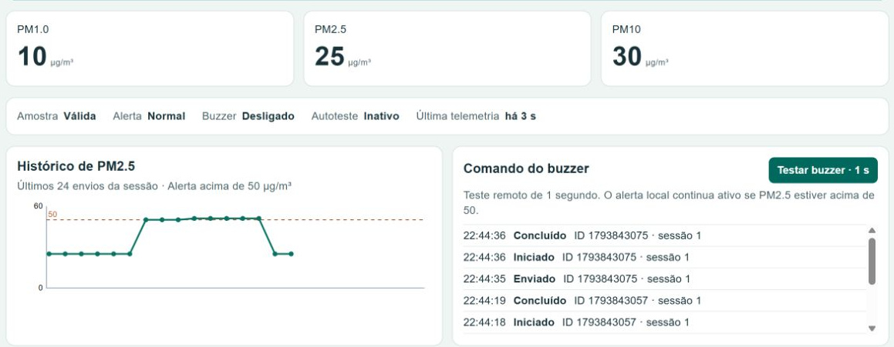
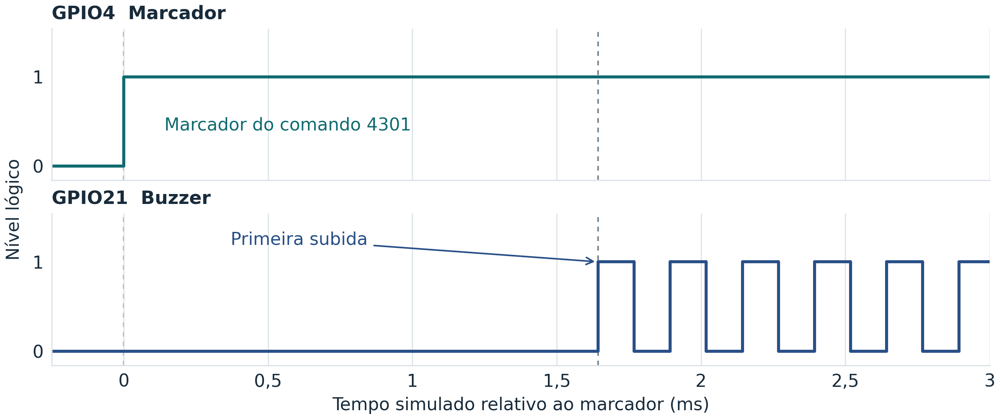

# Resultados dos ensaios do monitor de material particulado

A média estimada do percurso do sensor PMS5003 até o cliente MQTT foi **970 ms**, com intervalo de **510 a 1.440 ms**. Do envio do comando ao primeiro pulso do buzzer, a média estimada foi **490 ms**, com intervalo de **0 a 990 ms**. Os intervalos das médias se sobrepõem.

## Tempos de resposta

**Tabela 1 — Tempos de resposta nas quatro medições de cada percurso.**

| Núm. medida | Sensor/atuador | Tempo de resposta (ms) |
| --- | --- | ---: |
| 1 | Sensor PMS5003 | 1.320 [790–1.860] |
| 2 | Sensor PMS5003 | 670 [230–1.100] |
| 3 | Sensor PMS5003 | 900 [470–1.320] |
| 4 | Sensor PMS5003 | 1.010 [540–1.480] |
| **Média** | **Sensor PMS5003** | **970 [510–1.440]** |
| 1 | Buzzer no GPIO21 | 570 [0–1.150] |
| 2 | Buzzer no GPIO21 | 400 [0–800] |
| 3 | Buzzer no GPIO21 | 450 [0–910] |
| 4 | Buzzer no GPIO21 | 550 [0–1.110] |
| **Média** | **Buzzer no GPIO21** | **490 [0–990]** |

Fonte — Ensaios do projeto no Wokwi, com firmware instrumentado `pm-medicao`, broker público EMQX e cliente MQTT no computador. Cada linha mostra o ponto médio estimado seguido dos limites entre colchetes. A média usa os quatro pontos médios brutos, com o intervalo obtido pela média dos limites inferiores e dos superiores. O arredondamento foi feito ao final, em passos de 10 ms, com limites para fora. Os limites representam a incerteza da sincronização por sondas e o zero indica o limite inferior do intervalo.

**Gráfico 1 — Tempos de resposta por medida.** Os círculos indicam os pontos médios, os losangos as médias e os traços horizontais os intervalos. Os dois painéis usam a mesma escala em milissegundos.

## Funcionamento do protótipo

**Figura 1 —** Montagem em operação no Wokwi. O ESP32-S3 lê o PMS5003 simulado pela UART. O OLED mostra PM1.0, PM2.5 e PM10 de 10, 25 e 30 µg/m³, com estado NORMAL. O registro serial associado confirma a publicação de telemetria.

**Figura 2 —** Alerta local durante a falha simulada de comunicação. O OLED indica ALERTA com PM2.5 de 57 µg/m³ e a serial registra o buzzer ligado a 4 kHz e a falha de conexão TCP.

**Figura 3 —** Telemetria e comando no painel Node-RED. O ESP32 está online com PM2.5 de 25 µg/m³. O registro mostra envio, início e conclusão do comando 1793843075 na sessão 1. A saída voltou ao estado desligado ao terminar o autoteste.

As figuras 1 e 2 vêm do ensaio de rede, que usou o firmware `pm-autoteste` com o controle de falha habilitado. A figura 3 registra o autoteste pelo painel Node-RED. As três imagens são recortes das capturas dos ensaios. As quatro sessões de medição usaram a variante instrumentada `pm-medicao`.

**Figura 4 — Primeiro pulso do autoteste remoto na tentativa 04.** Na captura VCD do comando 4301, a primeira subida no GPIO21 aparece 1,644 ms após o marcador local no GPIO4. O trem de pulsos foi verificado a 4 kHz. O eixo mostra tempo simulado relativo ao marcador. O percurso MQTT completo corresponde à linha 4 do buzzer na tabela.

## Rastreabilidade

Os registros das quatro sessões acompanham o projeto. A síntese em JSON associa as linhas às sessões, às amostras, aos comandos e às capturas VCD. Ela também identifica os registros de origem das figuras de funcionamento. A tabela usa as oito medições aceitas. Os registros do piloto e da calibração ficam em `dados/piloto/` e `dados/calibracao/`.
